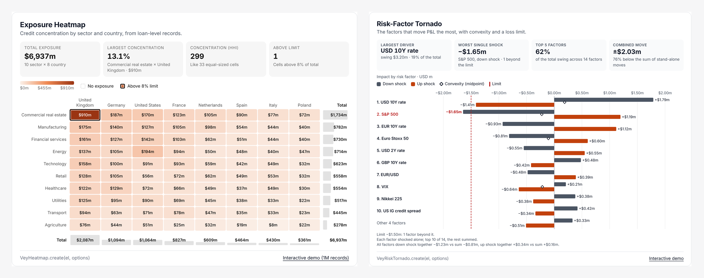

# Veyforma Charts

**Zero-dependency JavaScript charts for finance and risk teams.** Accessible, readable enough to edit, and nothing is sent to a server.

[](https://www.npmjs.com/package/@veyforma/charts)
[](dist/)
[](LICENSE)

[](https://veyforma.github.io/veyforma-charts/examples/)

General charting libraries give you bars and lines. Risk and finance teams need charts built around the questions they actually ask: *where is credit exposure concentrated?*, *which risk factors move P&L?*, *why doesn't the risk model's P&L match the front office's?*, *when does our debt fall due, and can we cover it?* This package answers those questions, in plain JavaScript, with no build step.

**[See the live demos →](https://veyforma.github.io/veyforma-charts/examples/)**

## Charts

| Chart | Answers | Size (gzip) | Demo |
|---|---|---|---|
| **Exposure Heatmap** | Where is exposure concentrated, by sector × country, sector × rating or any two fields? Sums loan-level records in the browser and outlines cells above your limit. | 12.5 KB | [Live](https://veyforma.github.io/veyforma-charts/examples/heatmap.html) |
| **Risk-Factor Tornado** | Which risk factors move P&L, economic value or capital the most? Down and up shocks, convexity, loss limits, groups and correlated contributions. | 15.3 KB | [Live](https://veyforma.github.io/veyforma-charts/examples/tornado.html) |
| **P&L Attribution** | Does the desk pass the FRTB P&L attribution test? HPL vs RTPL by factor, Spearman and KS zones, and the shortest path of fixes back to green. | 15.3 KB | [Live](https://veyforma.github.io/veyforma-charts/examples/pla-attribution.html) |
| **Debt Maturity Ladder** | When does our debt fall due, and can we cover it? Maturities by year or quarter, refinancing walls, start-by dates, liquidity cover and weighted average maturity. | 19.4 KB | [Live](https://veyforma.github.io/veyforma-charts/examples/debt-ladder.html) |

Every chart has keyboard-usable controls, tooltips on hover, tap and focus, a screen-reader description, and a built-in "How to read this chart" note.

**Fast:** in our tests the heatmap summed and drew 1,000,000 records in about 0.1 s (Chrome). [Try it in the demo](https://veyforma.github.io/veyforma-charts/examples/heatmap.html).

## Install

```bash
npm install @veyforma/charts
```

Or with no install, from a CDN: load every chart, or only the one you need.

```html
<!-- all charts -->
<script src="https://cdn.jsdelivr.net/npm/@veyforma/charts/dist/veyforma-charts.min.js"></script>

<!-- or one chart -->
<script src="https://cdn.jsdelivr.net/npm/@veyforma/charts/dist/veyforma-heatmap.min.js"></script>
```

## Quick start

```html
<div id="chart"></div>
<script src="https://cdn.jsdelivr.net/npm/@veyforma/charts/dist/veyforma-heatmap.min.js"></script>
<script>
  VeyHeatmap.create("#chart", {
    data: {
      title: "Loan exposure by sector and country",
      prefix: "$", suffix: "m",
      rowTitle: "Sector", columnTitle: "Country",
      rowLabels: ["Real estate", "Energy", "Retail", "Technology"],
      columnLabels: ["United Kingdom", "Germany", "France", "United States"],
      values: [
        [820, 310, 150, 240],
        [120, 260,  90, 610],
        [300, 180, 220,  60],
        [140,  90,  70, 380]
      ],
      limit: { share: 0.1 }   // outline any cell above 10% of the total
    }
  });
</script>
```

With a bundler:

```js
import VeyformaCharts from "@veyforma/charts";

const chart = VeyformaCharts.heatmap(document.getElementById("chart"), { data });
chart.update({ valueMode: "shareOfRow" }); // change any option
chart.destroy();                           // remove listeners and DOM
```

Pass any DOM element or CSS selector, so it works in plain HTML, React, Vue, Angular and Svelte. Importing on the server is safe: nothing touches the DOM until you call `create`.

## The charts

### Exposure Heatmap: `VeyHeatmap.create(el, options)`

Give either a ready-made grid (`values`, `rowLabels`, `columnLabels`) or loan-level `records` with any fields. The chart sums the records for whichever two fields you choose, and caches the sums so switching views is instant.

```js
VeyHeatmap.create("#chart", {
  data: {
    prefix: "$", suffix: "m",
    records: loans,                 // [{ sector: "Energy", country: "Germany", rating: "BBB", value: 12.5 }, …]
    rows: "sector", columns: "country",
    dimensions: { rating: { label: "Rating", order: ["AAA", "AA", "A", "BBB", "BB", "B", "CCC"], ordered: true } },
    limit: { share: 0.08 }
  },
  valueMode: "amount"               // "amount", "shareOfTotal", "shareOfRow" or "shareOfColumn"
});
```

| Option | Default | What it does |
|---|---|---|
| `rows`, `columns` | from `data` | Fields to show as rows and columns |
| `valueMode` | `"amount"` | Amount, or share of total, row or column |
| `scale` | `"linear"` | `"sqrt"` brings out small values |
| `limit` | from `data` | Concentration limit as a share of total, e.g. `0.05` |
| `topRows`, `topColumns` | `0` | Keep the largest N and group the rest as "Other" |
| `sortRows`, `sortColumns` | `"auto"` | `"total"` or `"natural"` |
| `theme` | `"veyforma"` | Theme name or object; add your own with `VeyHeatmap.registerTheme` |
| `onClick` | none | `function (cell, event)` |

### Risk-Factor Tornado: `VeyRiskTornado.create(el, options)`

Each factor gives either a delta and gamma with a shock size (Taylor), or the down and up results of a full revaluation.

```js
VeyRiskTornado.create("#chart", {
  data: {
    prefix: "$", suffix: "m", decimals: 2, limit: 1.5,
    correlation: { within: 0.7, across: 0.25 },   // for the contribution view
    factors: [
      { label: "USD 10Y rate", group: "Rates", unit: "bp", shock: 25, delta: -0.064, gamma: 0.0006 },
      { label: "EUR/USD", group: "FX", unit: "%", shockDown: -5, shockUp: 5, down: -0.48, up: 0.39 }
    ]
  }
});
```

| Option | Default | What it does |
|---|---|---|
| `view` | `"factors"` | `"factors"`, `"groups"` or `"contribution"` |
| `sort` | `"swing"` | Rank by `"swing"` or `"worst"` result |
| `top` | `15` | Rows shown before the rest are summed into "Other" |
| `shockScale` | `1` | Multiply every shock, e.g. `2` for double |
| `whatIf` | none | Scale positions by factor or group, e.g. `{ "FX": 0 }` |
| `onItemClick` | none | `function (detail, event)` |

For capital, where lower is better, add `higherIsBetter: false` to `data`. `VeyRiskTornado.compute(data, opts)` returns every figure without drawing.

### P&L Attribution: `VeyPlaAttribution.create(el, options)`

Give one HPL and one RTPL value per date for each risk factor. Leave `rtpl` out for a factor the risk model doesn't have.

```js
VeyPlaAttribution.create("#chart", {
  window: 250,
  data: {
    prefix: "$", suffix: "m", decimals: 2,
    dates: ["2026-09-28", "2026-09-29", "2026-09-30" /* … */],
    factors: [
      { label: "EUR 10Y", hpl: [0.42, -0.31, 0.18], rtpl: [0.40, -0.30, 0.19] },
      { label: "Vol smile", hpl: [0.05, 0.07, -0.03] }
    ]
  }
});
```

| Option | Default | What it does |
|---|---|---|
| `view` | `"factors"` | `"factors"`, `"daily"` or `"distribution"` |
| `window` | `250` | Test window in days (the most recent ones) |
| `fix` | none | Factors to treat as fixed (RTPL = HPL), e.g. `["Basis"]` |
| `thresholds` | Basel | `{ spearmanGreen, spearmanRed, ksGreen, ksRed }` |

Zones follow the Basel PLA test: green if Spearman > 0.80 and KS < 0.09, red if Spearman < 0.70 or KS > 0.12, otherwise amber. `VeyPlaAttribution.test(hpl, rtpl)` runs the test on two series.

### Debt Maturity Ladder: `VeyDebtLadder.create(el, options)`

Each facility needs a name, an amount outstanding and a maturity date. Add amortisation dates, a revolver `limit`, an `extension` option and a `coupon` as you have them, and `refinanceRate` to price refinancing at today's rates.

```js
VeyDebtLadder.create("#chart", {
  data: {
    asOf: "2026-10-31", prefix: "€", suffix: "m",
    cash: 120, cashFlow: 55,                      // liquidity sources for the coverage view
    facilities: [
      { name: "Term loan A", type: "Term loan", amount: 180, maturity: "2028-03-31",
        amortisation: [{ date: "2026-12-31", amount: 10 }, { date: "2027-03-31", amount: 10 }] },
      { name: "Bond 2028", type: "Bond", amount: 350, maturity: "2028-06-15", coupon: 0.01625 },
      { name: "Revolver", type: "Revolver", amount: 45, limit: 300, maturity: "2029-09-30", extension: { years: 1 } }
    ]
  }
});
```

| Option | Default | What it does |
|---|---|---|
| `view` | `"ladder"` | `"ladder"`, `"facilities"` or `"coverage"` |
| `period` | `"year"` | `"year"` or `"quarter"` |
| `stackBy` | `"type"` | Ladder segments by facility `"type"` or `"facility"` |
| `extensions` | `false` | `true` assumes every extension option is exercised |
| `whatIf` | none | Move maturities, e.g. `[{ facility: "Bond 2028", maturity: "2033-06-15" }]` |
| `wallShare` | `0.2` | A period holding more than this share of debt is a refinancing wall |
| `leadMonths`, `deadlineMonths` | `18`, `12` | When refinancing should start and be done, before maturity |
| `coverTarget` | `1.2` | Target for liquidity sources ÷ maturities over the next 12 months |

`VeyDebtLadder.compute(data, opts)` returns every figure without drawing, and also runs in Node.

### Shared methods

Every chart returns an instance with `update(options)`, `setData(data)`, `setTheme(theme)`, `describe()` (a plain-language summary), `createTable()` (an accessible data table) and `destroy()`.

## Chart menu and exports

The charts work fully on their own. The optional **Veyforma Toolkit** adds a chart menu with full screen, print, PNG, JPEG, SVG, PDF, CSV and Excel downloads, copy to clipboard and pinned notes. It's included in the free downloads on [veyforma.com](https://www.veyforma.com) (sign-in required), together with more sample data and a developer manual for each chart. Load it before the chart script and the menu appears automatically.

## Browser support

All evergreen browsers: Chrome, Edge, Firefox and Safari.

## More from Veyforma

These charts come from the [Veyforma Chart Library](https://www.veyforma.com), which has more risk and finance charts and complete dashboard prototypes for credit risk, market risk, capital and liquidity.

## Contributing

Bug reports and chart requests are welcome. See [CONTRIBUTING.md](CONTRIBUTING.md).

## License

[MIT](LICENSE) © 2026 Veyforma
